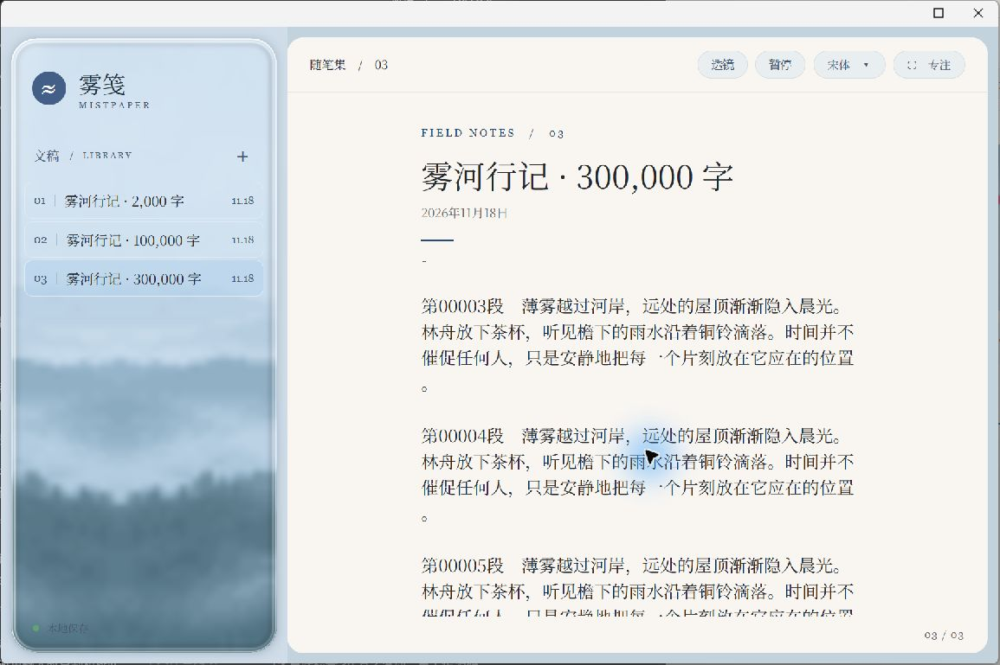

# 雾笺 · Mistpaper

原生中文写作客户端。纯 Rust 应用组件直接运行在 GPUI 中，沿用雾笺原型中双指滚动体验最好的渲染和输入后端。

正文居中，500 DIP 宽、20 DIP 字号、30 DIP 行高、自然字距，约每行 25 个汉字。提供宋体、楷体、仿宋和黑体，按文稿记忆字体；保留流动雾山、透镜玻璃侧栏和专注模式。



## 开发

Windows 需要 Rust stable、MSVC Build Tools 和 Windows SDK；脚本使用 PowerShell 7。在项目根目录运行：

```powershell
cargo run --release --locked
```

源码构建，不依赖实验目录、NSH CLI、预编译开发宿主或 Node.js。首次构建会下载固定版本的 NSH/GPUI 及其 Rust 依赖。Windows 编译大型图形依赖时建议：

```powershell
$env:RUST_MIN_STACK = '268435456'
$env:CARGO_BUILD_JOBS = '2'
```

创建可直接运行的 Windows 便携目录：

```powershell
./scripts/build.ps1
./dist/Mistpaper/mistpaper.exe
```

日常检查：

```powershell
cargo fmt --all --check
cargo test --release --locked
cargo clippy --release --locked --all-targets -- -D warnings
```

Windows CI 严格执行上述检查和便携目录构建；下载产物上传为可选步骤。上传失败会在 Actions 摘要中单独标注，代码验证通过不代表下载产物已发布。

## 目录

```text
src/main.rs          原生进程入口、平台目录和应用生命周期
src/app.rs           Rust 界面、原生 Input、中文排版和字体
src/model.rs         文稿模型；正文以 Arc<str> 共享
src/store.rs         合并保存任务、后台序列化和原子替换
assets/             雾山素材、内嵌欢迎文稿和玻璃 WGSL
scripts/            构建、长稿测试资料生成和测试启动
docs/               架构、性能与开发基线
.github/workflows/  Windows 检查与便携构建产物
```

## 数据

Windows 文稿保存在 `%APPDATA%/Mistpaper/library.json`；macOS 使用 `~/Library/Application Support/Mistpaper`，Linux 使用 `$XDG_DATA_HOME/Mistpaper` 或 `~/.local/share/Mistpaper`。字体选择和当前文稿也保存在该文件。

设置 `MISTPAPER_DATA_DIR` 可指定独立资料目录。正常退出时等待最新保存完成；后台合并保存的空闲窗口为 150 ms，持续输入时每秒发起一次保存。此前实验客户端的数据不自动迁入，新程序使用独立应用 ID。

## 性能与范围

发行版是单个 Rust 应用进程，文本排版、输入、滚动、绘制和保存均在原生代码中；没有 QuickJS、TSX 运行时、WebView、Electron 或浏览器 DOM。GPUI 使用原生图形后端绘制，应用不经过开发宿主启动。

NSH 固定到 `224d9a795c7ac9d10d75750de9351adac5549675`，GPUI Fast 固定为 `0.1.13`，与被选中的原型渲染版本一致。项目在 `vendor/nsh-platform-gpui` 保留了可视行绘制补丁，避免每帧提交 30 万字的全部字形。`Cargo.lock` 纳入版本控制，升级依赖需重新检查中文输入和触控板。

当前验收目标是 Windows。GPUI 本身支持 macOS/Linux，但本项目尚未在这两个系统上完成构建、IME 和真实手势验收。详见 [架构](docs/architecture.md) 和 [性能验证](docs/performance.md)。

界面使用系统已安装的字体，发行目录不附带界面字体；Windows 测试机已安装 Noto Serif SC。缺少字体时由系统回退。vendor 中的 Pacifico 字体仅用于上游后端测试，并附有 OFL 许可。

## 长稿测试

```powershell
./scripts/long-text.ps1
```

该脚本仅在 `.test-data/long-text` 首次创建独立的 2,000 / 100,000 / 300,000 字符中文合成稿，再运行发行版并记录帧统计。真实触控板的慢速移动、快速移动、抬手惯性和方向切换需要实际双指操作确认。测量边界和本次结果见性能文档。

项目采用 MIT 许可。依赖遵守各自许可，NSH 为 Apache-2.0；具体依赖版本见 `Cargo.lock`。
